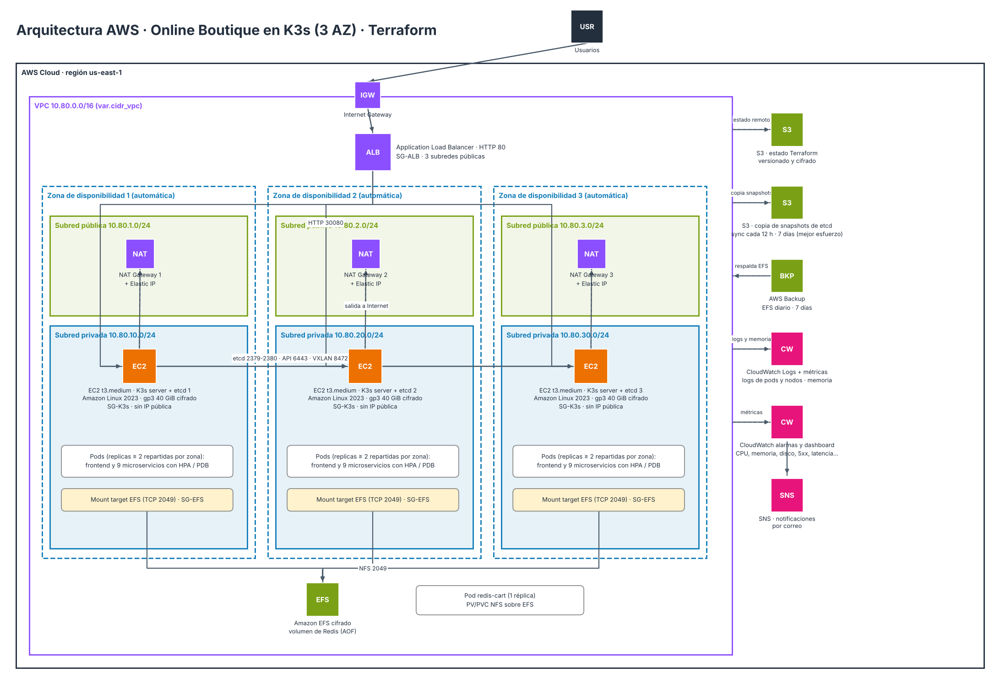

# Obligatorio – Implementación de Soluciones Cloud (ISC-N5A)

Despliegue automatizado de **Online Boutique** (e-commerce de microservicios) en AWS con **Terraform** y **K3s**, pensado para soportar picos de tráfico y la caída de una zona de disponibilidad.

**Estado:** la variante de cuatro comandos se desplegó exitosamente en AWS Academy y Online Boutique respondió HTTP 200 con tres targets saludables. Esto no acredita por sí solo todas las pruebas funcionales de respaldo, recuperación y observabilidad.



> Diagrama editable (draw.io, con iconografía AWS): [`docs/arquitectura.drawio`](docs/arquitectura.drawio).

## Correspondencia con la consigna

| Componente original | Equivalente en AWS |
|---|---|
| Load balancer | Application Load Balancer (HTTP 80 → NodePort 30080) |
| Dos servidores de aplicación | 3 EC2 `t3.medium` con K3s (etcd embebido), una por AZ; pods replicados |
| Base de datos | Redis (almacén de carritos de Online Boutique) con persistencia AOF sobre Amazon EFS cifrado |
| Solución de respaldos | AWS Backup (EFS, diario) + snapshots de etcd cada 12 h (copia a S3 con reintento, ver [`docs/RESPALDOS.md`](docs/RESPALDOS.md)) |

Detalle y justificación en [`docs/ARQUITECTURA.md`](docs/ARQUITECTURA.md).

## Documentación

| Documento | Contenido |
|---|---|
| [`docs/ARQUITECTURA.md`](docs/ARQUITECTURA.md) | Servicios AWS, red, cómputo, tolerancia a fallas y escalabilidad |
| [`docs/SEGURIDAD.md`](docs/SEGURIDAD.md) | Security Groups regla por regla y medidas de seguridad |
| [`docs/RESPALDOS.md`](docs/RESPALDOS.md) | Respaldos y procedimientos de recuperación |
| [`docs/MONITOREO.md`](docs/MONITOREO.md) | Alarmas, dashboard y logs centralizados |
| [`docs/OPERACION.md`](docs/OPERACION.md) | Despliegue, configuración, variables y operación |
| [`docs/COMPATIBILIDAD-AWS-ACADEMY.md`](docs/COMPATIBILIDAD-AWS-ACADEMY.md) | Restricciones de AWS Academy y decisiones tomadas por ellas |
| [`docs/PRUEBAS.md`](docs/PRUEBAS.md) | Pruebas de carga y de fallas (procedimiento y registro de resultados) |

## Inicio rápido — Terraform sin `desplegar.ps1`

Solo para una **cuenta AWS Academy limpia**, con AWS CLI v2 autenticado y PowerShell en Windows:

```powershell
cd terraform
terraform init
terraform validate
terraform plan
terraform apply
```

Antes de iniciar, copiar `terraform/terraform.tfvars.example` a `terraform/terraform.tfvars` y completar `alerta_mail` y `nombre_bucket`. El nombre del bucket S3 debe terminar con el ID de 12 dígitos de la cuenta AWS activa (se comprueba mediante AWS CLI). No es necesario crear buckets ni configurar SSH: no hay acceso SSH público a los nodos; se administra mediante SSM. Confirmar el plan antes de responder `yes` a `apply`.

En `apply`, Terraform configura VPC, seguridad, EC2, K3s, EFS, ALB, logs, AWS Backup, SNS y CloudWatch; luego invoca automáticamente **AWS CLI mediante PowerShell** para crear el bucket de snapshots y usar SSM para etiquetar las AZ, aplicar Online Boutique y realizar las validaciones. Los scripts auxiliares son parte de la ejecución de Terraform: **no hay que ejecutarlos manualmente**.

**Estado local:** el archivo `terraform/terraform.tfstate` contiene secretos como el token de K3s. La carpeta del proyecto debe permanecer privada; no subir el archivo ni las copias `.backup` a Git, no borrarlo y no intercambiarlo entre cuentas. Para trabajo en equipo simultáneo resulta más seguro un estado remoto con bloqueo, pero la consigna no exige esa modalidad.

**ADVERTENCIA:** no ejecutar esta variante con estado local vacío contra una cuenta que ya tiene el obligatorio creado. Terraform podría intentar crear recursos duplicados. No usarla en una cuenta que conserve infraestructura y un backend S3 de una ejecución anterior. Para una migración de estado existente hace falta un procedimiento específico y revisión previa; no usar `-reconfigure` para ocultar el estado anterior. Esta variante se ha probado con `apply` real, HTTP 200 y tres targets sanos. Las demás verificaciones deben documentarse por separado.

**Recuperación si falla la finalización de Kubernetes:** no borrar el estado ni ejecutar `destroy`. Revisar las salidas de Terraform/SSM. Una vez resuelta la causa, un operador puede planificar específicamente `-replace=terraform_data.finalizar_kubernetes`, previa revisión de su plan. El bucket de snapshots creado por AWS CLI es idempotente y queda fuera de la gestión de destrucción de Terraform para preservar las copias.

Más detalle en [`docs/OPERACION.md`](docs/OPERACION.md).

## Requisitos y versiones

| Componente | Versión |
|---|---|
| Windows PowerShell | 5.1 o PowerShell 7 |
| AWS CLI | v2 |
| Terraform | `>= 1.5.0` (CI con 1.9.x) |
| Proveedor `hashicorp/aws` | `~> 5.0` (versión exacta en `terraform/.terraform.lock.hcl`) |
| Proveedor `hashicorp/random` | `~> 3.6` |
| K3s | `v1.37.2+k3s1` (variable `version_k3s`) |
| Online Boutique | `v0.10.7` |
| k6 (solo pruebas de carga) | cualquiera reciente |

## Estructura del repositorio

| Ruta | Función |
|---|---|
| `terraform/` | Raíz de Terraform (`main.tf`, `variables.tf`, `outputs.tf`, `providers.tf`) |
| `terraform/modules/network/` | VPC, subredes, Internet Gateway, NAT |
| `terraform/modules/security/` | Security Groups y reglas |
| `terraform/modules/compute/` | EC2 K3s (user_data), ALB y Target Group |
| `terraform/modules/storage/` | EFS y AWS Backup |
| `terraform/modules/logging/` | Grupo de CloudWatch Logs de nodos y pods |
| `terraform/modules/monitoring/` | Alarmas, dashboard y SNS |
| `kubernetes/app.yaml` | Manifiestos de Online Boutique, HPA y PDB |
| `pruebas/` | Scripts de carga (k6) y de falla de instancia |
| `docs/` | Documentación y diagrama |
| `terraform/automatizacion.tf` | Arranque del bucket etcd y finalización de Kubernetes dentro de `terraform apply` |
| `terraform/scripts/` | Scripts auxiliares llamados exclusivamente por Terraform |

## Uso de inteligencia artificial

Se utilizó **ChatGPT de OpenAI** como herramienta de apoyo en el diseño de la arquitectura, la elaboración y revisión de Terraform, los scripts PowerShell, los manifiestos Kubernetes y la documentación técnica.

Los resultados generados o revisados con asistencia de IA fueron evaluados por el equipo. La responsabilidad por el funcionamiento, las pruebas, las decisiones de arquitectura y la entrega corresponde a sus integrantes.

## Fuentes

- Consigna ORT: *ISC-N5A – Obligatorio, agosto 2026*.
- Proyecto Google Online Boutique: <https://github.com/GoogleCloudPlatform/microservices-demo>
- Documentación de K3s: <https://docs.k3s.io/>
- Documentación de Terraform: <https://developer.hashicorp.com/terraform/docs>
- Documentación oficial de AWS: <https://docs.aws.amazon.com/>


## Nota de portabilidad y AWS Academy

En esta variante, Terraform conserva estado local y genera el bucket de snapshots etcd mediante AWS CLI invocado desde un provisioner. Esto evita la consulta Object Lock bloqueada por SCP en AWS Academy. La ruta `terraform apply` fue probada en AWS Academy; las verificaciones de resiliencia y restauración requieren evidencias adicionales. El antiguo `desplegar.ps1` conserva el flujo con backend S3 y **no debe mezclarse** con el nuevo flujo de estado local.
