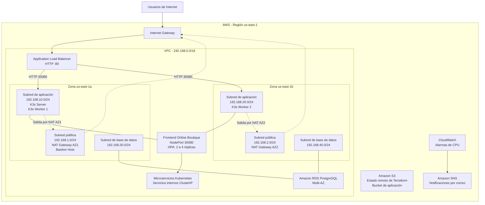

# Soluciones Cloud – Obligatorio

**Universidad ORT Uruguay**
**Carrera:** Analista en Infraestructura Informática
**Asignatura:** Soluciones Cloud

**Tecnologías:** AWS · Terraform · Kubernetes (K3s) · Docker · Git

## 1. Descripción del proyecto

El objetivo del proyecto es diseñar, implementar y administrar una infraestructura en Amazon Web Services (AWS) que permita ejecutar una aplicación web basada en microservicios, utilizando servicios de nube e infraestructura como código.

La solución implementada utiliza **Online Boutique**, una aplicación de comercio electrónico desplegada sobre un clúster Kubernetes mediante K3s.

La infraestructura se encuentra distribuida entre dos zonas de disponibilidad de AWS e incorpora segmentación de red, balanceo de carga, escalabilidad automática, recuperación de pods, monitoreo y controles de seguridad.

Los componentes de infraestructura se definen principalmente mediante **Terraform**, mientras que los recursos de Kubernetes se gestionan mediante manifiestos YAML.

### Objetivos

- Automatizar el aprovisionamiento de infraestructura AWS mediante Terraform.
- Diseñar una red virtual segmentada en subredes públicas y privadas.
- Distribuir componentes entre dos zonas de disponibilidad.
- Implementar un clúster Kubernetes con K3s.
- Desplegar Online Boutique mediante microservicios.
- Publicar la aplicación mediante un Application Load Balancer.
- Implementar escalabilidad horizontal automática.
- Comprobar la recuperación automática de pods.
- Incorporar monitoreo y alertas.
- Documentar la arquitectura, su funcionamiento y los procedimientos de administración.

## 2. Arquitectura de la solución

La infraestructura se despliega en la región `us-east-1`.

| Componente | Configuración |
|---|---|
| Región AWS | us-east-1 |
| Zona de disponibilidad 1 | us-east-1a |
| Zona de disponibilidad 2 | us-east-1b |
| VPC | 192.168.0.0/16 |
| Infraestructura como código | Terraform |
| Plataforma de contenedores | K3s |
| Aplicación | Online Boutique |
| Entrada pública | Application Load Balancer |
| Escalabilidad | Kubernetes HPA |
| Base de datos AWS | Amazon RDS PostgreSQL |
| Almacenamiento AWS | Amazon S3 |
| Monitoreo | Amazon CloudWatch |
| Alertas | Amazon SNS |

### 2.1. Diagrama de arquitectura



El diagrama representa la organización lógica de la infraestructura y las comunicaciones principales.

Los usuarios acceden a Online Boutique mediante el ALB público. El balanceador envía el tráfico HTTP al puerto `30080` de los nodos K3s y Kubernetes lo dirige hacia los pods disponibles del frontend.

Los microservicios se comunican internamente mediante servicios Kubernetes.

Amazon RDS se encuentra desplegado como un componente independiente de la infraestructura y no participa en el procesamiento de solicitudes de Online Boutique.

## 3. Infraestructura de red

### 3.1. VPC y subredes

Se implementó una VPC con el bloque:

`192.168.0.0/16`

La red se organiza en seis subredes distribuidas entre dos zonas de disponibilidad.

| Subred | Zona | CIDR | Propósito |
|---|---|---|---|
| Pública AZ1 | us-east-1a | 192.168.1.0/24 | Recursos públicos |
| Pública AZ2 | us-east-1b | 192.168.2.0/24 | Recursos públicos |
| Aplicación AZ1 | us-east-1a | 192.168.10.0/24 | Nodos K3s |
| Aplicación AZ2 | us-east-1b | 192.168.20.0/24 | Nodos K3s |
| Base de datos AZ1 | us-east-1a | 192.168.30.0/24 | RDS |
| Base de datos AZ2 | us-east-1b | 192.168.40.0/24 | RDS |

Esta segmentación permite separar los componentes según su función y sus necesidades de conectividad.

### 3.2. Internet Gateway

La VPC dispone de un Internet Gateway para habilitar la comunicación de sus recursos públicos con Internet.

Las tablas de rutas de las subredes públicas utilizan el Internet Gateway como destino para el tráfico hacia redes externas.

### 3.3. NAT Gateways

Se utilizan dos NAT Gateways:

- Un NAT Gateway en la zona `us-east-1a`.
- Un NAT Gateway en la zona `us-east-1b`.

Estos componentes permiten que los recursos de las subredes privadas de aplicación inicien conexiones hacia Internet sin necesitar direcciones IP públicas.

Cada zona dispone de su propio NAT Gateway, reduciendo la dependencia de un único punto de salida.

### 3.4. Tablas de rutas

Las tablas de rutas determinan los destinos del tráfico dentro de la VPC y hacia redes externas.

Las subredes públicas disponen de una ruta predeterminada hacia el Internet Gateway.

Las subredes privadas de aplicación utilizan las rutas de salida configuradas hacia los NAT Gateways correspondientes.

El tráfico interno entre subredes de la VPC se enruta mediante la conectividad local de AWS, sujeto a las reglas de seguridad aplicables.

## 4. Application Load Balancer

La aplicación se publica mediante un **Application Load Balancer (ALB)** de AWS.

| Parámetro | Valor |
|---|---|
| Nombre | cloud-obligatorio-alb |
| Esquema | Internet-facing |
| Listener | HTTP |
| Puerto público | 80 |
| Target Group | cloud-obligatorio-k3s-tg |
| Protocolo hacia los nodos | HTTP |
| Puerto de destino | 30080 |
| Health Check | / |
| Respuesta esperada | HTTP 200 |

El ALB se encuentra asociado con las subredes públicas de ambas zonas de disponibilidad.

Su Target Group registra los tres nodos K3s, permitiendo dirigir solicitudes a la aplicación a través del servicio NodePort.

### 4.1. Acceso público

La aplicación se encuentra disponible en:

http://cloud-obligatorio-alb-643673029.us-east-1.elb.amazonaws.com/

La dirección corresponde al despliegue de AWS utilizado durante las pruebas y puede cambiar si se recrea el balanceador.

### 4.2. Flujo de solicitudes

1. El usuario accede a la dirección pública del ALB.
2. El listener HTTP recibe la solicitud en el puerto 80.
3. El Target Group selecciona un destino disponible.
4. La solicitud llega a un nodo K3s mediante el puerto 30080.
5. El servicio Kubernetes dirige el tráfico a un pod disponible del frontend.
6. El frontend se comunica con los microservicios internos necesarios para atender la solicitud.

## 5. Clúster Kubernetes con K3s

Se implementó un clúster Kubernetes utilizando **K3s** sobre instancias Amazon EC2.

La arquitectura utiliza un servidor de control y dos nodos worker.

### 5.1. Nodos

| Nodo | IP privada | Zona de disponibilidad | Función |
|---|---|---|---|
| K3s Server | 192.168.10.152 | us-east-1a | Control Plane y ejecución de pods |
| K3s Worker 1 | 192.168.10.63 | us-east-1a | Worker |
| K3s Worker 2 | 192.168.20.83 | us-east-1b | Worker |

Los tres nodos utilizan Amazon Linux 2023.

El servidor K3s se encarga de las funciones de control del clúster y también puede ejecutar pods de la aplicación.

Los workers proporcionan capacidad adicional de cómputo para distribuir los microservicios.

### 5.2. Componentes Kubernetes

La implementación utiliza los componentes propios de K3s y Kubernetes:

- API Server.
- Scheduler.
- Controller Manager.
- Kubelet.
- Containerd.
- CoreDNS.
- Metrics Server.
- Flannel.

Flannel proporciona conectividad entre los pods distribuidos en los distintos nodos.

Metrics Server permite obtener métricas de CPU y memoria utilizadas, entre otras funciones, por el Horizontal Pod Autoscaler.

Traefik y ServiceLB se encuentran deshabilitados en el servidor K3s. El acceso público de la aplicación se implementa mediante el ALB de AWS.

### 5.3. Administración del clúster

Las instancias utilizan el perfil IAM `LabInstanceProfile`, proporcionado por el entorno AWS Academy.

Se utiliza AWS Systems Manager para ejecutar comandos administrativos sobre el servidor K3s, según los permisos disponibles en el entorno.

Algunos comandos de administración habituales son:

```bash
kubectl get nodes -o wide
kubectl get pods -o wide
kubectl get deployments
kubectl get services
kubectl get hpa
kubectl top nodes
kubectl top pods
```

### 5.4. Distribución entre zonas

El frontend utiliza `topologySpreadConstraints` con la etiqueta:

`topology.kubernetes.io/zone`

Esta configuración permite distribuir sus réplicas entre nodos ubicados en distintas zonas de disponibilidad.

Durante las verificaciones se comprobó la existencia de réplicas del frontend tanto en `us-east-1a` como en `us-east-1b`.

### 5.5. Limitación del Control Plane

El clúster dispone de un único servidor K3s en `us-east-1a`.

Por lo tanto, el Control Plane constituye un punto único de fallo.

Una interrupción de ese servidor puede afectar la administración del clúster, la programación de nuevos pods y las operaciones de recuperación que requieren el plano de control.

La distribución entre dos zonas mejora la disponibilidad de las cargas de trabajo, pero no equivale a una arquitectura Kubernetes de alta disponibilidad completa.

## 6. Aplicación Online Boutique

**Online Boutique** es una aplicación de comercio electrónico basada en microservicios.

Se ejecuta mediante Deployments y Services de Kubernetes.

### 6.1. Microservicios desplegados

| Microservicio | Función |
|---|---|
| frontend | Interfaz web de la tienda |
| adservice | Publicidad y promociones |
| cartservice | Administración del carrito |
| checkoutservice | Proceso de compra |
| currencyservice | Conversión de monedas |
| emailservice | Notificaciones por correo |
| paymentservice | Simulación de pagos |
| productcatalogservice | Catálogo de productos |
| recommendationservice | Recomendaciones |
| shippingservice | Gestión y cálculo de envíos |
| redis-cart | Almacenamiento de datos del carrito |

Los once componentes conforman la aplicación desplegada en el clúster.

### 6.2. Imagen del frontend

El Deployment del frontend utiliza la imagen:

`matiasbp/online-boutique-interfaz:1.0`

Esta imagen contiene la interfaz personalizada utilizada en el proyecto.

### 6.3. Comunicación entre servicios

Los microservicios internos utilizan servicios Kubernetes de tipo `ClusterIP`.

La comunicación interna se realiza mediante los nombres de servicio y los puertos definidos en sus manifiestos.

El frontend se encuentra expuesto mediante un servicio `NodePort`.

| Parámetro | Valor |
|---|---|
| Puerto del contenedor frontend | 8080 |
| NodePort | 30080 |
| Acceso externo | AWS Application Load Balancer |

### 6.4. Manifiestos Kubernetes

Los manifiestos están organizados en la carpeta `kubernetes/`.

```text
kubernetes/
├── adservice.yaml
├── cartservice.yaml
├── checkoutservice.yaml
├── currencyservice.yaml
├── emailservice.yaml
├── frontend-hpa.yaml
├── frontend.yaml
├── paymentservice.yaml
├── productcatalogservice.yaml
├── recommendationservice.yaml
├── redis.yaml
└── shippingservice.yaml
```

Estos archivos definen los recursos necesarios para ejecutar la aplicación dentro de Kubernetes.

## 7. Escalabilidad horizontal automática

La solución utiliza un **Horizontal Pod Autoscaler (HPA)** para ajustar automáticamente la cantidad de réplicas del frontend de acuerdo con la utilización de CPU.

### 7.1. Configuración del HPA

| Parámetro | Valor |
|---|---|
| Nombre | frontend-hpa |
| Deployment | frontend |
| Métrica | CPU |
| Objetivo | 60 % |
| Réplicas mínimas | 2 |
| Réplicas máximas | 4 |
| CPU solicitada por pod | 100m |
| Límite de CPU por pod | 200m |
| Memoria solicitada | 64Mi |
| Límite de memoria | 128Mi |

La utilización porcentual del HPA se calcula respecto de la CPU solicitada por los contenedores.

Cuando el consumo aumenta por encima del objetivo, Kubernetes puede incrementar la cantidad de réplicas, respetando el máximo configurado.

Cuando la utilización disminuye, el HPA puede reducirlas, respetando el mínimo y sus mecanismos de estabilización.

### 7.2. Prueba de escalabilidad

**Fecha:** 19 de noviembre de 2026.

Se realizó una prueba de carga sobre el ALB público de Online Boutique.

Condiciones de la prueba:

- Duración: 120 segundos.
- Concurrencia: 10 trabajadores HTTP.
- Acceso mediante el ALB.
- Sin modificar manualmente la cantidad de réplicas.

Resultados:

| Indicador | Resultado |
|---|---|
| Solicitudes HTTP exitosas | 4.898 |
| Solicitudes fallidas | 0 |
| Tasa de éxito registrada | 100 % |
| Réplicas iniciales | 2 |
| Réplicas máximas alcanzadas | 4 |
| Réplicas al finalizar la estabilización | 2 |

El HPA registró eventos `SuccessfulRescale`.

La secuencia observada fue:

**2 → 3 → 4 → 3 → 2 réplicas**

Los eventos confirmaron que el aumento se produjo por la utilización de CPU por encima del objetivo configurado.

La reducción posterior ocurrió cuando las métricas volvieron a encontrarse por debajo del objetivo.

Durante el escalado se comprobaron cuatro pods del frontend disponibles y distribuidos entre ambas zonas.

**Resultado:** escalabilidad horizontal y reducción automática verificadas satisfactoriamente.

## 8. Recuperación automática ante fallos

Los Deployments de Kubernetes mantienen un número deseado de réplicas.

Si se pierde un pod administrado por un Deployment, Kubernetes intenta crear otro para recuperar el estado deseado.

### 8.1. Prueba de recuperación

**Fecha:** 19 de noviembre de 2026.

Se realizó una prueba controlada eliminando un pod del frontend mientras existían dos réplicas disponibles.

Estado inicial:

- Dos pods del frontend.
- Ambos `Running` y `Ready`.
- Uno en cada zona de disponibilidad.

Se eliminó el siguiente pod:

`frontend-5cf8cb86d5-68d4l`

Comando utilizado:

```bash
kubectl delete pod frontend-5cf8cb86d5-68d4l -n default
```

Kubernetes creó automáticamente el pod de reemplazo:

`frontend-5cf8cb86d5-n9qt5`

El nuevo pod quedó en estado:

`1/1 Running`

El frontend recuperó sus dos réplicas:

| Zona | Réplicas recuperadas |
|---|---|
| us-east-1a | 1 |
| us-east-1b | 1 |

Después de la recuperación se verificó nuevamente el acceso a la aplicación mediante el ALB.

**Resultado:** recuperación automática de un pod y restauración del estado deseado del Deployment verificadas.

Esta prueba demuestra recuperación ante un fallo de pod. No representa una simulación de caída completa de una instancia EC2 ni de una zona de disponibilidad.

## 9. Amazon RDS

La infraestructura incluye una base de datos administrada mediante **Amazon RDS para PostgreSQL**.

### 9.1. Configuración

| Parámetro | Valor |
|---|---|
| Motor | PostgreSQL |
| Versión | 16 |
| Clase | db.t3.micro |
| Multi-AZ | Habilitado |
| Cifrado | Habilitado |
| Retención de backups | 7 días |
| Ubicación | Subredes privadas de base de datos |

### 9.2. Disponibilidad

RDS utiliza una implementación Multi-AZ administrada por AWS.

Esta configuración está orientada a mejorar la disponibilidad ante determinados fallos de infraestructura o del servicio de base de datos.

### 9.3. Seguridad

La base de datos se encuentra en subredes privadas.

Su Security Group no permite conexiones entrantes en la configuración actual.

### 9.4. Relación con la aplicación

RDS se mantiene como un componente independiente de infraestructura.

Los microservicios de Online Boutique no utilizan esta instancia PostgreSQL.

La implementación de RDS permite trabajar con un servicio administrado de base de datos, sus mecanismos de seguridad, backups y disponibilidad.

## 10. Amazon S3

La infraestructura utiliza Amazon S3 para almacenamiento de objetos y del estado de Terraform.

### 10.1. Backend remoto de Terraform

Bucket:

`cloud-obligatorio-tfstate-2026`

Su función es almacenar el estado remoto de Terraform.

El bucket tiene versionado habilitado.

El estado remoto centraliza el registro de los recursos administrados y facilita la continuidad de la administración de infraestructura entre distintas sesiones de trabajo.

**Este bucket no debe eliminarse mientras siga siendo utilizado como backend.**

### 10.2. Bucket de aplicación

Bucket:

`cloud-obligatorio-app-bergara-ocampo-2026`

Se utiliza como recurso de almacenamiento S3 del proyecto.

Cuenta con:

- Acceso privado.
- Cifrado.
- Versionado.

El despliegue de Online Boutique utiliza imágenes de contenedores y manifiestos Kubernetes.

## 11. Seguridad

La infraestructura aplica controles de acceso mediante segmentación de red, Security Groups y permisos IAM disponibles en el entorno.

### 11.1. Security Groups

Los Security Groups controlan las comunicaciones autorizadas entre los componentes.

Se utilizan reglas específicas para:

- Acceso HTTP al ALB.
- Comunicación del ALB con los nodos K3s.
- Comunicaciones necesarias para el clúster.
- Acceso administrativo al Bastion Host.
- Aislamiento de RDS.

Los nodos K3s y la base de datos se encuentran en subredes privadas.

### 11.2. Bastion Host

El Bastion Host proporciona un punto de acceso administrativo SSH.

El Security Group correspondiente restringe el origen autorizado para conexiones SSH.

La dirección autorizada se configura mediante una variable de Terraform, permitiendo administrar el acceso sin habilitar SSH indiscriminadamente desde Internet.

### 11.3. IAM y Systems Manager

Las instancias K3s utilizan el perfil:

`LabInstanceProfile`

Este perfil corresponde al entorno AWS Academy.

Mediante AWS Systems Manager se ejecutan comandos de administración en el servidor K3s conforme a los permisos disponibles.

### 11.4. Protección de información sensible

No se deben publicar contraseñas, claves privadas, tokens ni credenciales de AWS.

El repositorio utiliza `.gitignore` para excluir archivos sensibles y temporales, incluidos:

- Archivos `terraform.tfvars` con valores reales.
- Archivos de estado locales.
- Directorios `.terraform/`.
- Planes temporales de Terraform.
- Archivos de credenciales y claves privadas.

Se recomienda verificar los cambios preparados antes de cada commit.

## 12. Monitoreo y notificaciones

La infraestructura utiliza Amazon CloudWatch para supervisar métricas de recursos AWS.

### 12.1. Alarmas CloudWatch

Se encuentran configuradas:

| Recurso | Métrica | Umbral |
|---|---|---|
| K3s Server | CPUUtilization | 80 % |
| K3s Worker 1 | CPUUtilization | 80 % |
| K3s Worker 2 | CPUUtilization | 80 % |
| RDS PostgreSQL | CPUUtilization | 80 % |

Las alarmas permiten detectar condiciones de utilización elevada de CPU.

### 12.2. Notificaciones SNS

Amazon SNS se utiliza para enviar notificaciones mediante correo electrónico.

Las alarmas CloudWatch están asociadas a un tópico SNS.

Para recibir las notificaciones, la suscripción correspondiente debe encontrarse confirmada.

### 12.3. Monitoreo del clúster

El estado de Kubernetes puede consultarse mediante:

```bash
kubectl get nodes
kubectl get pods -A
kubectl top nodes
kubectl top pods
kubectl get hpa
kubectl describe hpa frontend-hpa
```

Estas consultas permiten verificar la disponibilidad de recursos y observar el comportamiento del escalado automático.

## 13. Terraform

Terraform permite describir los recursos AWS mediante código declarativo.

Se utiliza una estructura modular para organizar los componentes de la infraestructura.

### 13.1. Estructura general

```text
terraform/
├── main.tf
├── variables.tf
├── outputs.tf
├── providers.tf
├── modules/
│   ├── alb/
│   ├── bastion/
│   ├── db/
│   ├── k3s/
│   ├── monitoring/
│   ├── network/
│   ├── s3/
│   └── security/
└── ...
```

El contenido exacto de cada módulo se organiza mediante los archivos Terraform correspondientes.

### 13.2. Módulos

| Módulo | Responsabilidad |
|---|---|
| network | VPC, subredes, IGW, NAT Gateways y rutas |
| security | Security Groups y reglas de acceso |
| bastion | Bastion Host |
| s3 | Buckets S3 |
| alb | Application Load Balancer y Target Group |
| k3s | Instancias EC2 del clúster |
| db | Amazon RDS PostgreSQL |
| monitoring | CloudWatch y SNS |

### 13.3. Variables

Entre las variables principales se encuentran:

- `region_aws`
- `nombre_proyecto`
- `cidr_ssh_bastion`
- `ruta_clave_publica_ssh`
- `id_ami_bastion`
- `usuario_bd`
- `contrasena_bd`
- `administrar_contrasena_maestra_rds`
- `proteccion_eliminacion_rds`
- `nombre_bucket_aplicacion`
- `usar_s3_nativo`
- `correo_alertas`
- `habilitar_k3s`
- `nombre_perfil_iam_k3s`

Los valores deben adaptarse al entorno AWS donde se ejecutará la infraestructura.

Las contraseñas y demás secretos no deben incluirse en archivos versionados.

### 13.4. Backend

Terraform utiliza un backend remoto S3.

La configuración del backend requiere que el bucket correspondiente esté creado y disponible antes de inicializar Terraform.

El estado remoto contiene información necesaria para administrar los recursos de infraestructura, por lo que debe protegerse y conservarse.

## 14. Procedimiento de implementación

Esta sección describe el procedimiento general para preparar y desplegar la solución.

La instalación y unión de los nodos K3s debe realizarse con el procedimiento de configuración correspondiente al entorno, antes de aplicar los manifiestos de Online Boutique.

### 14.1. Requisitos

Para trabajar con el proyecto se necesita:

- Una cuenta AWS con permisos adecuados.
- Terraform.
- AWS CLI.
- Git.
- Una clave pública SSH cuando corresponda.
- Acceso administrativo al clúster K3s mediante `kubectl`.

### 14.2. Obtener el código

```bash
git clone https://github.com/mbergarap/CLOUD.git
cd CLOUD
```

### 14.3. Preparar Terraform

Ingresar a la carpeta:

```bash
cd terraform
```

Configurar los valores de las variables correspondientes al entorno de despliegue.

Es necesario disponer de acceso al backend remoto S3 y de credenciales AWS válidas.

### 14.4. Inicializar Terraform

```bash
terraform init
```

Este comando prepara el directorio de trabajo, descarga los proveedores necesarios e inicializa el backend configurado.

### 14.5. Validar los archivos

```bash
terraform fmt -check -recursive
terraform validate
```

El primer comando comprueba el formato.

El segundo verifica que la configuración sea válida desde el punto de vista estructural.

### 14.6. Revisar los cambios

```bash
terraform plan
```

Antes de aplicar la infraestructura deben revisarse todos los recursos que Terraform propone crear, modificar o destruir.

### 14.7. Aplicar la infraestructura

En un entorno autorizado, después de revisar el plan:

```bash
terraform apply
```

**Advertencia:** este comando puede modificar recursos existentes. No debe ejecutarse sin analizar previamente el plan y el impacto de los cambios.

La instalación y configuración del clúster K3s debe completarse conforme a su procedimiento específico.

### 14.8. Verificar los nodos K3s

Con el clúster configurado:

```bash
kubectl get nodes -o wide
```

Los tres nodos deben aparecer en estado `Ready`.

### 14.9. Desplegar Online Boutique

Desde la raíz del repositorio, con `kubectl` conectado al clúster correcto:

```bash
kubectl apply -f kubernetes/
```

Este comando aplica los manifiestos Kubernetes de la aplicación y del HPA.

### 14.10. Verificar el despliegue

```bash
kubectl get deployments
kubectl get pods
kubectl get services
kubectl get hpa
```

Se debe comprobar que los Deployments estén disponibles y que los pods se encuentren en estado `Running` y `Ready`.

### 14.11. Comprobar la aplicación

Una vez configurado el ALB, verificar que Online Boutique responda mediante la dirección pública.

También puede utilizarse:

```bash
curl -I http://cloud-obligatorio-alb-643673029.us-east-1.elb.amazonaws.com/
```

La respuesta esperada es:

`HTTP/1.1 200 OK`

## 15. Verificaciones realizadas

Se realizaron pruebas funcionales y operativas de la infraestructura y de la aplicación.

| Verificación | Resultado |
|---|---|
| ALB público | Operativo |
| Respuesta HTTP de Online Boutique | HTTP 200 |
| Nodos K3s | 3/3 Ready |
| Frontend | Réplicas disponibles |
| Distribución del frontend | Dos AZ |
| HPA | Métricas de CPU disponibles |
| Escalado horizontal | 2 → 4 réplicas |
| Reducción automática | 4 → 2 réplicas |
| Prueba HTTP bajo carga | 4.898 solicitudes exitosas |
| Errores HTTP durante la prueba | 0 |
| Recuperación ante eliminación de pod | Exitosa |
| Disponibilidad posterior a recuperación | Verificada |

### 15.1. Consumo de recursos

Durante una verificación del clúster se registraron los siguientes valores:

| Nodo | Utilización CPU | Utilización memoria |
|---|---|---|
| K3s Server | 4 % | 25 % |
| K3s Worker 1 | 2 % | 23 % |
| K3s Worker 2 | 2 % | 20 % |

Estos valores corresponden a una medición puntual y pueden variar dependiendo de la carga.

### 15.2. Resultados de escalabilidad

La prueba de carga confirmó que el HPA fue capaz de aumentar y reducir automáticamente las réplicas del frontend.

No fue necesario modificar manualmente el número de pods para producir el escalado.

### 15.3. Resultados de recuperación

La eliminación controlada de un pod permitió comprobar el funcionamiento del controlador de Deployment.

Kubernetes creó automáticamente un pod de reemplazo y recuperó la cantidad de réplicas configurada.

## 16. Disponibilidad y limitaciones

La arquitectura incorpora mecanismos que contribuyen a mejorar la disponibilidad:

- Dos zonas de disponibilidad.
- Application Load Balancer.
- Tres nodos K3s.
- Réplicas del frontend.
- Distribución de frontend entre zonas.
- Recuperación automática de pods.
- HPA.
- NAT Gateways por zona.
- RDS Multi-AZ.

Sin embargo, la solución presenta limitaciones que deben considerarse.

**Control Plane único:** el servidor K3s no cuenta con una réplica del plano de control.

**Microservicios internos:** no todos los componentes de Online Boutique disponen de múltiples réplicas.

**HTTP público:** el ALB utiliza HTTP y no tiene configurada terminación HTTPS en esta implementación.

**Escalabilidad de nodos:** el HPA ajusta la cantidad de pods del frontend, pero no implica un aumento automático de la cantidad de instancias EC2 del clúster.

**Integración de RDS:** RDS funciona como componente independiente, sin conexión con Online Boutique.

Estas limitaciones distinguen la funcionalidad implementada de una arquitectura de alta disponibilidad completa.

## 17. Posibles mejoras

Como futuras mejoras se identifican:

1. Implementar alta disponibilidad del Control Plane K3s.
2. Incorporar múltiples réplicas para más microservicios.
3. Implementar HTTPS mediante certificados y un listener TLS en el ALB.
4. Automatizar el escalado de los nodos del clúster.
5. Ampliar el monitoreo y la observabilidad de Kubernetes.
6. Consolidar un procedimiento completamente automatizado y reproducible para la configuración de K3s.
7. Realizar pruebas controladas de fallo de instancias o zonas de disponibilidad.

Estas mejoras no se consideran implementadas en la solución actual.

## 18. Costos y administración

Los servicios utilizados pueden generar costos mientras permanezcan activos.

Entre los principales componentes se encuentran:

- Amazon EC2.
- Application Load Balancer.
- NAT Gateways.
- Amazon RDS.
- Amazon S3.
- Amazon CloudWatch.

El uso de múltiples zonas de disponibilidad y componentes redundantes puede incrementar el costo de operación.

Se recomienda revisar los recursos activos y controlar los costos del entorno AWS durante el desarrollo y las pruebas.

La eliminación de infraestructura debe realizarse de forma controlada.

No se debe ejecutar `terraform destroy` ni eliminar el bucket utilizado como backend remoto sin analizar previamente las consecuencias.

## 19. Control de versiones

El proyecto utiliza Git para mantener versionados:

- Los archivos Terraform.
- Los módulos de infraestructura.
- Los manifiestos Kubernetes.
- La documentación.

Repositorio de desarrollo:

https://github.com/mbergarap/CLOUD

El control de versiones permite registrar modificaciones, revisar cambios y mantener una referencia del código utilizado para administrar la infraestructura.

## 20. Conclusión

El obligatorio de Soluciones Cloud permitió implementar una solución de infraestructura AWS administrada mediante Terraform y orientada a ejecutar una aplicación de microservicios sobre Kubernetes.

La arquitectura integra redes privadas, balanceo de carga, cómputo, almacenamiento, base de datos administrada, seguridad, monitoreo y notificaciones.

Online Boutique se ejecuta sobre un clúster K3s distribuido entre dos zonas de disponibilidad, con acceso público mediante un Application Load Balancer.

Las pruebas realizadas permitieron demostrar:

- Disponibilidad de la aplicación a través del ALB.
- Escalabilidad horizontal automática del frontend.
- Reducción automática de réplicas al disminuir la carga.
- Recuperación automática frente a la eliminación de un pod.
- Distribución de réplicas entre ambas zonas de disponibilidad.
- Funcionamiento de los mecanismos de monitoreo y consulta de métricas.

El proyecto permite aplicar conceptos fundamentales de Soluciones Cloud mediante una infraestructura funcional, modular y administrada como código, reconociendo las limitaciones técnicas de la implementación y las oportunidades de mejora para alcanzar mayores niveles de disponibilidad y automatización.