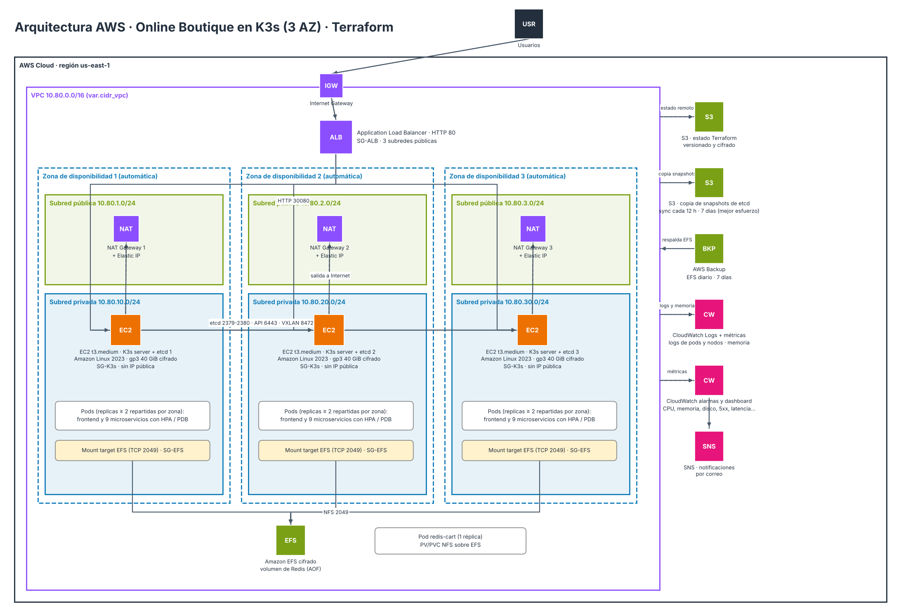

# Arquitectura

## Servicios de AWS utilizados

| Servicio | Uso |
|---|---|
| VPC, subredes, Internet Gateway, NAT Gateway, Elastic IP | Red en 3 AZ: 3 subredes públicas y 3 privadas |
| EC2 | 3 servidores K3s, sin IP pública |
| Application Load Balancer | Entrada pública HTTP 80 |
| Amazon EFS | Volumen persistente del pod de Redis |
| AWS Backup | Respaldo diario de EFS |
| Amazon S3 | Copias de los snapshots de etcd (bucket creado mediante AWS CLI invocado por Terraform; estado Terraform local) |
| CloudWatch (métricas, alarmas, dashboard, Logs) y SNS | Monitoreo, logs y notificaciones |
| Systems Manager (SSM) | Administración de instancias sin SSH |

## Datos de la infraestructura

| Elemento | Valor |
|---|---|
| Región | `us-east-1` (variable `region`) |
| VPC | `10.80.0.0/16` (variable `cidr_vpc`) |
| Subredes públicas | `10.80.1.0/24`, `10.80.2.0/24`, `10.80.3.0/24` |
| Subredes privadas | `10.80.10.0/24`, `10.80.20.0/24`, `10.80.30.0/24` |
| Zonas de disponibilidad | Las 3 primeras disponibles de la región |
| EC2 | `t3.medium` (variable `tipo_instancia`), Amazon Linux 2023, EBS gp3 40 GiB cifrado |
| K3s | 3 servidores con etcd embebido (quórum 2 de 3), sin Traefik ni ServiceLB |
| ALB | Público, listener HTTP 80, Target Group TCP 30080, health check `GET /` esperando 200 |
| NAT | 1 por AZ: cada subred privada sale por su propia zona |

## Equivalencia con la solución original

- **Base de datos.** Online Boutique no usa una base relacional: el único dato persistente es el carrito, guardado en Redis. Por eso la capa de persistencia es Redis con AOF (`appendfsync everysec`) sobre EFS cifrado, replicado en 3 AZ. Redis corre con **1 réplica** a propósito: dos instancias escribiendo el mismo AOF sobre NFS lo corromperían. Si el pod o el nodo caen, Kubernetes lo reprograma en otra zona y recupera los datos desde EFS.
- **Respaldos.** Ver [RESPALDOS.md](RESPALDOS.md).

## Tolerancia a fallas

| Falla | Comportamiento |
|---|---|
| Pierde un pod | Kubernetes lo recrea; cada servicio tiene ≥ 2 réplicas |
| Pierde un nodo / una AZ | Quedan 2 de 3 miembros de etcd (quórum); el ALB deja de enviarle tráfico por health check; los pods se reprograman |
| Fallo del host subyacente | La alarma `StatusCheckFailed_System` avisa por SNS. La acción automática `ec2:recover` solo se activa con `habilitar_recuperacion_ec2 = true` (por defecto `false`, pendiente de validar permisos en AWS Academy) |
| Pierde Redis | Se reprograma y recupera el AOF desde EFS |
| Mantenimiento | `PodDisruptionBudget` (`minAvailable: 1`) en los 10 servicios |

**Límite conocido:** con dos nodos caídos a la vez se pierde el quórum de etcd. Las EC2 son instancias individuales (no un Auto Scaling Group): una instancia terminada no se recrea sola; se recupera con `terraform apply`.

## Escalabilidad

- **Pods:** HPA en el frontend (2–4, CPU 60 %) y en cartservice, checkoutservice, productcatalogservice, recommendationservice y currencyservice (2–4, CPU 70 %).
- **Distribución:** `topologySpreadConstraints` por zona (y por nodo en el frontend).
- **Capacidad:** con las réplicas mínimas los pods piden ~2,5 vCPU y ~2,7 GiB sobre 6 vCPU y 12 GiB del clúster; con todos los HPA al máximo, ~3,9 vCPU.
- **Límite conocido:** los nodos no escalan (3 instancias fijas). Si el HPA agotara la capacidad, haría falta subir `tipo_instancia`.
