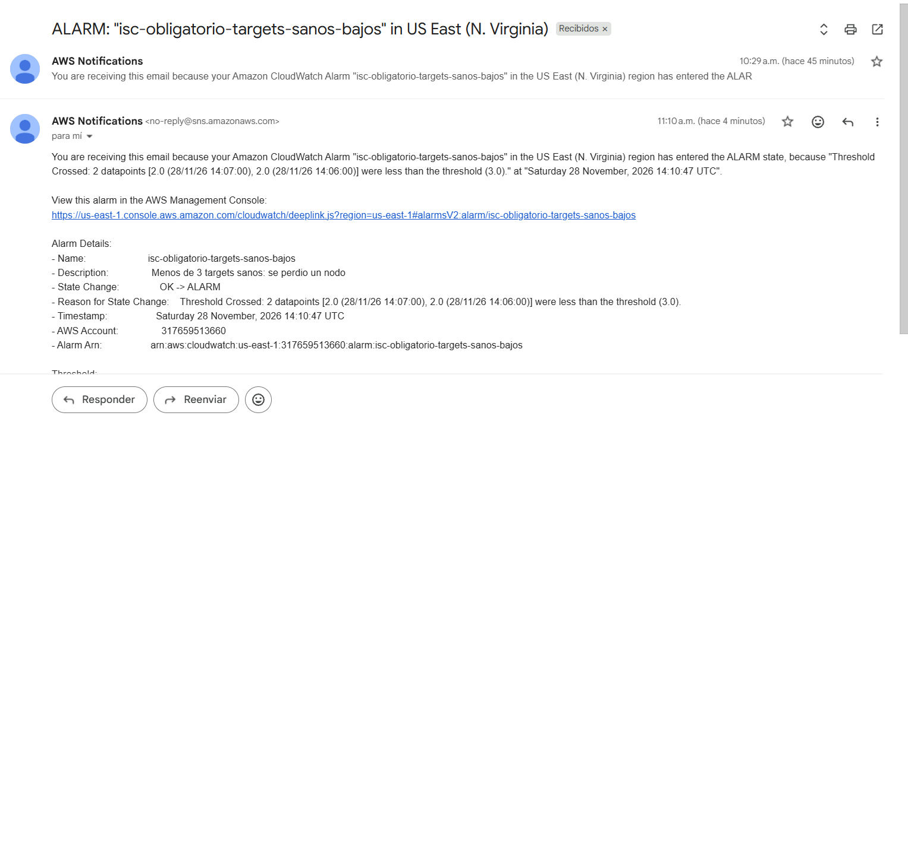
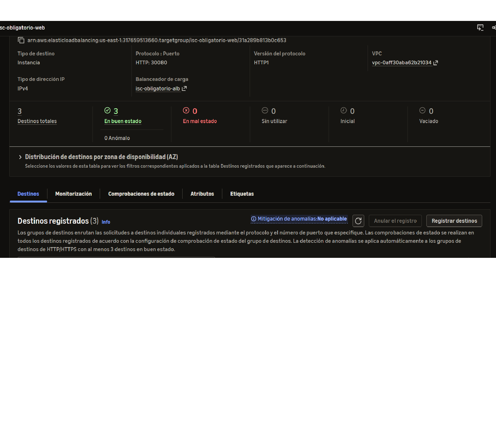

# Pruebas

Registro de evidencia de las pruebas realizadas sobre el despliegue real en AWS Academy (28/11/2026). Los resultados son salidas reales de cada prueba. Los puntos marcados como **pendiente** no se probaron o no se verificaron.

Las horas de los paneles de CloudWatch se muestran en UTC; las de los scripts de PowerShell, en hora local (UTC-3).

## Verificaciones del despliegue

El despliegue se hace solo con `terraform apply`. La asociación de SSM (`terraform/automatizacion.tf`) espera en el servidor principal hasta que K3s y la tienda estén listos: `cloud-init` terminado, 3 nodos `Ready`, frontend con 2 réplicas y HTTP 200 por el ALB. Además se comprobó a mano: 3 EC2 en SSM, 3 nodos `Ready`, microservicios disponibles, Redis `PONG` con AOF, PVC enlazado, HPA/PDB creados, 17 alarmas, grupo de logs, dashboard, plan de AWS Backup, suscripción SNS, ≥ 2 targets sanos y HTTP 200.

Resultado: despliegue completo, 3 nodos `Ready`, 3 targets sanos y HTTP 200 en el ALB.

## 1. Prueba de carga

```powershell
.\pruebas\prueba-carga.ps1 -Pico 100
# en otra terminal, dentro de un nodo: kubectl get hpa -w
```

Perfil (`pruebas/carga.k6.js`): 6 min, calentamiento, subida y pico sostenido. Umbrales: errores < 1 % y p95 < 2 s.

| Dato | Resultado |
|---|---|
| Fecha y pico de usuarios virtuales | 28/11/2026, 100 usuarios virtuales |
| Solicitudes totales / por segundo | 25.676 solicitudes, 70,8 por segundo |
| Errores (%) | 0 % |
| p95 de latencia | 499 ms según k6 (521 ms según CloudWatch) |
| Réplicas máximas alcanzadas por el HPA (frontend) | 4 (el máximo configurado), en unos 2 minutos |
| Alarmas que se dispararon | Ninguna (CPU de los nodos ≤ 43 %) |

Observaciones: el HPA del frontend superó el 170 % de CPU sobre el objetivo del 60 % y escaló de 2 a 4 réplicas. También escaló `currencyservice` (de 2 a 3). Tras terminar la carga, el frontend volvió a 2 réplicas en unos 35 minutos (ventana de estabilización del HPA).

## 2. Falla de una instancia / una AZ

```powershell
.\pruebas\prueba-fallo-instancia.ps1 -Indice 1 -DuracionMinutos 5
```

Detiene una EC2 (equivale a perder una AZ), mide HTTP y targets sanos cada 5 s, la vuelve a iniciar y genera un CSV con el detalle.

Esta prueba se hizo tres veces. La primera encontró dos fallos de diseño, que se corrigieron antes de la segunda. La segunda mostró que la alarma no avisaba de la caída de un nodo; se corrigió y la tercera lo confirmó.

### 2.1 Primera ejecución (antes de corregir): fallida

| Dato | Resultado |
|---|---|
| Disponibilidad HTTP durante la falla | 5,56 % (1 de 18 consultas con HTTP 200) |
| Mínimo de targets sanos | 0 |
| Recuperación | No se recuperó sola; hubo que reiniciar los frontends a mano |

Los datos salen del resumen que imprimió el script en esa ejecución (el CSV de esta primera ejecución fue sobrescrito por la siguiente y no se conservó).

**Diagnóstico.** Con una sola instancia detenida cayeron los 3 targets. Los nodos de Kubernetes y etcd estaban sanos (quorum 2/3 y 3 nodos `Ready`), pero el health check del ALB (`GET /`, timeout de 5 s) fallaba. En los nodos, `/_healthz` del frontend respondía 200 en 1 ms mientras que `/` se colgaba. Causas:

1. **El liveness del frontend consultaba `/_healthz`**, que responde 200 aunque la página real esté colgada. Los frontends mantienen conexiones gRPC abiertas con cart y currency. Al apagar el nodo, esas conexiones quedaron esperando a pods que ya no existían (sin FIN ni RST) y Kubernetes no reiniciaba el frontend.
2. **Los microservicios estaban casi todos en el mismo nodo.** Se desplegaron cuando solo existía un nodo, así que la restricción de reparto por zona no tuvo con qué repartirlos. Si caía ese nodo, caía casi toda la tienda.

### 2.2 Correcciones

- `kubernetes/app.yaml`: el `livenessProbe` del frontend ahora consulta `/` con `periodSeconds: 10`, `timeoutSeconds: 5` y `failureThreshold: 3`. Un frontend colgado se reinicia solo en unos 30 s.
- Se reiniciaron los deployments para que se repartieran entre los 3 nodos. Resultado: cada servicio con sus 2 réplicas en nodos distintos.

### 2.3 Segunda ejecución (con las correcciones): correcta

La instancia detenida fue la del nodo `ip-192-168-20-189`, el que más pods tenía (10 servicios).

| Dato | Resultado |
|---|---|
| Disponibilidad HTTP durante la falla | 82,35 % (28 de 34 consultas con HTTP 200); 100 % desde los 98 s |
| Mínimo de targets sanos | 2 |
| Tiempo hasta recuperar el servicio (con la instancia aún apagada) | 98 s hasta el primer HTTP 200 |
| Tiempo hasta que el ALB retiró el target | 106 s (los targets sanos pasaron de 3 a 2) |
| Tiempo hasta recuperar 3 targets sanos | El script informó recuperación a 3 targets tras reiniciar la instancia (ver CSV) |
| ¿Llegó la alarma por correo? | No (ver 2.4) |

Durante los primeros 90 s hubo errores (502, 500 y timeouts) mientras el ALB y Kubernetes detectaban la caída. Después, el servicio respondió con HTTP 200 de forma continua durante el resto de la prueba, con una instancia menos, sin intervención manual.

Detalle en `pruebas/resultado-fallo-instancia-2-despues-de-corregir.csv`.

### 2.4 Tercera ejecución (con la alarma corregida): correcta

En la segunda ejecución no llegó ningún correo. La métrica `UnHealthyHostCount` solo marcó 1 durante un minuto: cuando la instancia está detenida, el ALB pasa el target a `unused` y deja de contarlo como no saludable. La alarma `targets-sanos-bajos` avisaba con menos de 2 targets sanos, y con un nodo caído quedan 2. Se cambió el umbral a **menos de 3** (`terraform/modules/monitoring/main.tf`) y se aplicó con `terraform apply` (1 recurso modificado, 0 destruidos).

| Dato | Resultado |
|---|---|
| Disponibilidad HTTP durante la falla | 93,18 % (41 de 44 consultas con HTTP 200) |
| Fallos | 3 `HTTP=0` intercalados en los primeros 90 s; desde los 96 s, 100 % de respuestas 200 |
| Mínimo de targets sanos | 2 |
| Tiempo hasta que el ALB retiró el target | 96 s |
| Recuperación a 3 targets sanos | Sí, tras reiniciar la instancia |
| ¿Llegó la alarma por correo? | Sí: `isc-obligatorio-targets-sanos-bajos` pasó a `ALARM` y llegó el correo (captura en `docs/evidencias/alarma-targets-sanos-bajos-correo.png`) |

Detalle en `pruebas/resultado-fallo-instancia-3-con-alarma.csv`.





**Limitación.** El corte inicial de hasta 90 s es el tiempo que tardan en sumarse la detección del ALB (intervalo de 30 s, 2 chequeos) y el reinicio de los frontends. Se podría acortar bajando el intervalo del health check del ALB; no se hizo para no modificar la infraestructura ya desplegada.

## 3. Falla de un pod

```bash
kubectl delete pod -l app=frontend --wait=false
kubectl get pods -w
```

| Dato | Resultado |
|---|---|
| Tiempo de recuperación | Pod nuevo en `1/1` en unos 13 s |
| ¿Hubo errores visibles? | No: 90 de 90 consultas HTTP con 200 (1 consulta por segundo), 0 errores |

Con 2 réplicas y un PodDisruptionBudget (`minAvailable: 1`), siempre hay al menos un frontend atendiendo.

## 4. Respaldos

| Prueba | Resultado |
|---|---|
| Existe un recovery point de AWS Backup (EFS) | Sí: trabajo de respaldo `COMPLETED` al 100 % |
| Se restauró el recovery point | **Pendiente (no probado)** |
| Llegan snapshots de etcd a `s3://<nombre_bucket>/snapshots/` (la copia se intenta a los 20 min del arranque y luego cada 12 h) | Sí: snapshot de unos 9,2 MB en el bucket |
| Se probó la restauración de etcd | **Pendiente (no probado)** |
| Llegan logs al grupo de CloudWatch `/isc-obligatorio/k3s` | Sí: streams `<instancia>/pods` y `<instancia>/instalacion` con eventos recientes en las tres instancias |
| Llegan métricas de memoria (`CWAgent`) y las alarmas de memoria/disco salen de «sin datos» | Sí: el namespace `CWAgent` publica `mem_used_percent` y `disk_used_percent`; las alarmas `memoria-*` y `disco-*` pasaron de «sin datos» a `OK` a los pocos minutos del despliegue |

## 5. Despliegue desde cero con `terraform apply`

Se probó en una cuenta de AWS Academy vacía (sin instancias, balanceadores ni buckets), solo con `terraform apply` y sin ningún script ni paso manual. Se hizo en cuatro intentos y cada fallo llevó a una corrección.

| Intento | Resultado | Causa y corrección |
|---|---|---|
| 1 | Una instancia no pudo descargar K3s y su arranque falló; la tienda no se desplegó sola | La descarga se hacía una sola vez. Ahora `primary.sh.tftpl` y `secondary.sh.tftpl` reintentan hasta 8 veces |
| 2 | El servidor principal abortó antes de desplegar la tienda; `terraform apply` terminó con error en `aws_ssm_association.verificar_kubernetes` | `BucketAlreadyExists`: el nombre del bucket de etcd ya lo usaba otra cuenta de AWS (los nombres de bucket son únicos en todo AWS). Con la verificación SSM se vio `cloud-init status: error`. Ahora el paso del bucket va al final, con la tienda ya desplegada |
| 3 | Correcto, sin intervención | Con un `nombre_bucket` único. El apply terminó unos minutos antes de que la tienda respondiera |
| 4 | Correcto, sin intervención, con el código final (bucket al final del arranque) | El apply terminó en unos 8 minutos y la tienda respondió HTTP 200 apenas terminó. El bucket de etcd se creó a las 13:43:38, al final del arranque y con la tienda ya desplegada |

Resultado del tercer intento (83 recursos creados, 0 errores; antes se habían destruido 83 con `terraform destroy`, sin que la vault de AWS Backup bloqueara el borrado):

| Dato | Resultado |
|---|---|
| Nodos K3s | 3 `Ready`, uno por zona |
| Pods | 21 `Running` y `1/1`; cada servicio con sus 2 réplicas en nodos distintos |
| Reinicios | Un reinicio de cada frontend durante el arranque, porque su liveness consulta `/` y esa página necesita a `currencyservice`; después estable |
| Targets del ALB | 3 `healthy` |
| HTTP por el ALB | 200 |
| Verificación SSM | `Success`, tardó unos 3 minutos (13:15:53 a 13:18:46) y terminó con «K3S Y ONLINE BOUTIQUE DISPONIBLES. HTTP 200» |
| Suscripción SNS | Confirmada por correo |

**Limitación observada en el tercer intento.** `terraform apply` dio `Apply complete!` unos 2 o 3 minutos antes de que terminara el script de verificación, así que durante ese tiempo el ALB respondió 502 mientras arrancaban los pods. La tienda quedó disponible sola unos minutos después. En el cuarto intento no se repitió: el apply esperó a la verificación y la tienda respondió 200 de inmediato. Como no se reproduce siempre, conviene comprobar que el ALB responda HTTP 200 antes de usar la URL.

**Requisito.** `nombre_bucket` debe ser único en todo AWS; si ya existe en otra cuenta, el respaldo de etcd a S3 no se configura (la tienda sí queda desplegada).

## Resumen de hallazgos

| Hallazgo | Impacto | Estado |
|---|---|---|
| Liveness del frontend no detectaba la página colgada | Sitio caído tras perder un nodo | Corregido en `kubernetes/app.yaml` |
| Microservicios concentrados en un solo nodo | Un nodo caído tira casi toda la tienda | Corregido: `primary.sh.tftpl` espera a los 3 nodos y a sus etiquetas de zona antes de aplicar `app.yaml` (verificado en el despliegue desde cero, sección 5) |
| La alarma de targets no avisaba al perder un nodo | Caída de un nodo sin notificación | Corregido: umbral `< 3` en `targets-sanos-bajos`, verificado con correo real |
| Corte de hasta 90 s al caer un nodo | Errores visibles breves (3 de 44 consultas en la última prueba) | Documentado; mejorable ajustando el health check |
| La descarga de K3s fallaba una vez y dejaba un nodo sin cluster | Despliegue desde cero incompleto | Corregido: hasta 8 reintentos en el arranque |
| Un `nombre_bucket` ya usado en otra cuenta abortaba el arranque antes de desplegar la tienda | Tienda sin desplegar | Corregido: el paso del bucket se hace al final (verificado en el cuarto intento) |
| `terraform apply` terminó unos minutos antes de que la tienda respondiera (una de las dos veces que se vio) | 502 breve tras el apply | No reproducible siempre; documentado, comprobar HTTP 200 |
